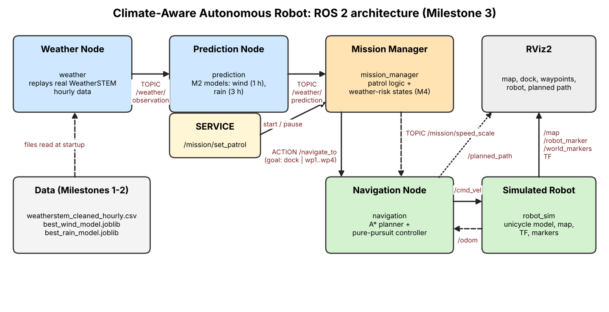

# climate_robot (Milestone 3)

A simulated patrol robot in a small 2D world, built with ROS 2 Jazzy. The robot starts on its dock, visits four patrol waypoints while avoiding four obstacles, and returns to the dock. The weather nodes (real WeatherSTEM replay plus the Milestone 2 ML models) are already wired in; weather-based decisions are switched on in Milestone 4.



## Nodes and interfaces

| Node | Role | Interfaces |
|---|---|---|
| `weather` | replays real hourly observations from the cleaned CSV | publishes topic `/weather/observation` |
| `prediction` | wind speed 1 h ahead, rain within 3 h (Milestone 2 models) | subscribes observation, publishes topic `/weather/prediction` |
| `mission_manager` | patrol sequence, weather-risk states (M4) | **service** `/mission/set_patrol`, **action client** `/navigate_to`, topics `/mission/state`, `/mission/speed_scale` |
| `navigation` | A* path planning + pure-pursuit control | **action server** `/navigate_to`, topics `/cmd_vel`, `/planned_path` |
| `robot_sim` | unicycle robot, map, TF, RViz markers | `/cmd_vel` in; `/odom`, `/map`, `/world_markers`, `/robot_marker`, TF out |

Custom interfaces are in `climate_robot_interfaces` (`WeatherObservation`, `WeatherPrediction`, `NavigateTo`).

The world (12 x 10 m, dock, 4 waypoints, 4 obstacles) is defined in `config/world.yaml`.

## Build

Put both folders (`climate_robot` and `climate_robot_interfaces`) in `~/ros2_ws/src`, then:

```bash
cd ~/ros2_ws
pip install --break-system-packages scikit-learn==1.8.0 joblib pandas   # same sklearn that trained the models
source /opt/ros/jazzy/setup.bash
colcon build --symlink-install
source install/setup.bash
```

## Run

Navigation demo (Milestone 3: one lap, then back to the dock):

```bash
ros2 launch climate_robot navigation_demo.launch.py
ros2 launch climate_robot navigation_demo.launch.py laps:=2 rviz:=false   # options
```

Full pipeline with the weather and prediction nodes (needs `weatherstem_cleaned_hourly.csv`, `best_wind_model.joblib`, `best_rain_model.joblib` in `~/ros2_ws`, or pass `data_dir:=...`):

```bash
ros2 launch climate_robot full_system.launch.py
```

Useful commands while it runs:

```bash
ros2 service call /mission/set_patrol std_srvs/srv/SetBool "{data: false}"   # pause
ros2 service call /mission/set_patrol std_srvs/srv/SetBool "{data: true}"    # resume
ros2 topic echo /mission/state
ros2 topic echo /weather/prediction
ros2 action send_goal /navigate_to climate_robot_interfaces/action/NavigateTo "{target: wp2}" --feedback
rqt_graph
```

If RViz is blank or crashes under WSL: `export LIBGL_ALWAYS_SOFTWARE=1` before launching.

## Tests (no ROS needed)

```bash
cd ~/ros2_ws/src/climate_robot
pip install pytest numpy pyyaml
CLIMATE_DATA_DIR=~/ros2_ws python3 -m pytest test -q
python3 scripts/offline_demo.py          # writes docs/patrol_trajectory.png and docs/patrol.gif
```

The navigation logic is plain Python (`world`, `planner`, `controller`, `kinematics`, `state_machine`, `features`), so it is tested without ROS. The ROS nodes are thin wrappers around it.
